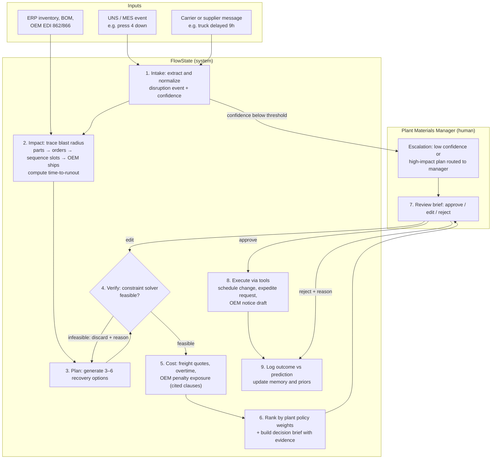
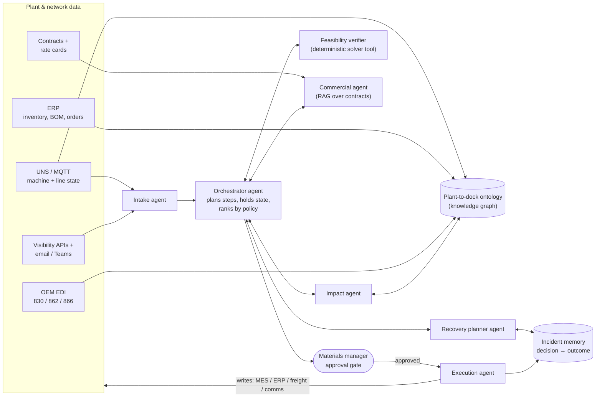

# FlowState: Line-Down Recovery Agent for Automotive Tier-1 Plants

**Version:** v0.1 (first draft) · **Date:** 2026-11-27 · **Status:** Draft for course review (Week 1 written in full; Weeks 2–5 preliminary, *D-007*) · **Format:** this Markdown file is the source of truth (*D-006*)
**Author:** Jing Li · **Course:** AI PM (Mahesh Yadav, Maven)
**Decision trail:** every major choice below links to an entry in [docs/decision-log.md](docs/decision-log.md) (e.g. *D-001*). Checklist results are in [docs/self-evaluation.md](docs/self-evaluation.md).

---

## TL;DR

| Item | Summary |
|---|---|
| **Problem** | When an inbound part is late or a machine goes down, a Tier-1 supplier plant has hours to rebuild its production and shipping plan before it misses the OEM's just-in-time / just-in-sequence window. Today that plan is assembled by hand across MES, ERP, carrier emails, OEM EDI releases and phone calls. |
| **User** | Plant Materials Manager at an automotive Tier-1 supplier plant (one persona; *D-001*, *D-003*). |
| **Product** | A multi-agent system that detects the disruption, traces its blast radius, generates recovery options, **verifies them with a deterministic constraint solver**, costs them against freight and OEM penalty terms, and hands the manager a ranked, cited recovery plan to approve. On approval it executes the changes (*D-004*). |
| **Wedge** | The plant-level recovery decision that joins shop-floor state, in-transit freight and customer contract exposure. Logistics-visibility platforms (project44) and planning suites (Blue Yonder, Kinaxis, o9) each own one side of this seam; FlowState sits at the seam and integrates with both (*D-002*). |
| **North Star** | Time-to-approved-recovery-plan: from disruption detected to plan approved. Target is under 20 minutes, from an assumed 2–4 hour baseline (*D-005*). |

---

# WEEK 1

## Section 1. PROBLEM DEFINITION

### What problem is this solving?

Automotive production runs on just-in-time inventory. Companies "may maintain only a few days, or even a few hours, of inventory at any given time," and "if even one supplier in the chain fails to meet its obligations, the effects can be felt throughout the supply chain" ([Michigan Bar Journal, 2019](https://www.michbar.org/file/barjournal/article/documents/pdf4article3774.pdf)).

A Tier-1 supplier sits in the middle of that chain. It builds seats, wire harnesses or thermal modules and ships them to an OEM assembly plant, often in the exact build sequence of the vehicles on the OEM's line. When something breaks upstream or inside the plant, the materials manager has to answer four questions fast:

1. **What is affected?** Which parts, work orders, sequence slots and OEM shipments, and when does the line run out?
2. **What could we do?** Re-sequence production, move work to another line, pull ahead other orders, transfer stock from a sister plant, expedite by hot-shot truck or air, or partial-ship and notify the customer.
3. **Which options are physically possible?** That depends on capacity, changeovers, labor, material on hand and sequence rules.
4. **What does each option cost?** Premium freight, overtime, and OEM penalty or chargeback exposure.

Today the answers sit in five or more disconnected places: MES/SCADA (or a Unified Namespace), ERP inventory and BOM, carrier and 3PL emails and portals, OEM EDI releases (830 planning schedule, 862 shipping schedule, 866 production sequence), and the customer contract. The manager reconciles them by hand in spreadsheets, Teams and phone calls. Every hour spent reconciling removes cheaper options and pushes the plant toward air freight. The supplier usually pays for that: "In most industries, buyers expect their suppliers to pay any expedited freight needed to ensure timely delivery," and air freight "can cost tens of thousands of dollars per day" ([Michigan Bar Journal, 2019](https://www.michbar.org/file/barjournal/article/documents/pdf4article3774.pdf)).

**Job-to-be-done (user):**
> "When an inbound shipment slips or a machine goes down, I want to see the full impact and a short list of physically feasible, costed recovery options in one place, so that I can approve the best one and execute it in minutes instead of hours, before my customer's line is at risk."

**Job-to-be-done (buyer):**
> "When disruptions hit our plants, I want recovery decisions to be fast, consistent and auditable, so that we protect margin from premium freight and chargebacks and keep our OEM scorecards green."

**A day in the life (illustrative scenario, synthetic data):**
At 06:10 a carrier emails that a truck carrying recliner mechanisms is stuck at a border crossing, with a 9-hour delay. The seating plant has 5 hours of that part on hand and ships to the OEM in sequence every 2 hours. The materials manager finds out at 07:30, then spends until 10:00 pulling inventory from ERP, checking which seat variants use the part, calling the carrier, asking the scheduler whether trim-level B seats can run first, and getting a hot-shot quote. By then two options have expired, and the plant books an expensive expedite. FlowState's target: the same decision approved by 06:30.

### Who are you solving this problem for?

**Primary persona: Plant Materials Manager, automotive Tier-1 supplier** (*D-001*, *D-003*)

| Attribute | Detail |
|---|---|
| Role | Plant Materials Manager / Production Control Manager. Owns inbound material, plant inventory and the production schedule's material feasibility; production schedulers and material planners report in. |
| Industry | Automotive Tier-1 suppliers shipping JIT/JIS: seating, interiors, wire harnesses, thermal and HVAC modules, battery-pack subassemblies. These are high-mix, sequence-delivered parts where one missing component stops a customer line. |
| Plant profile | Single plant shipping to 1–3 OEM assembly plants, with hours to days of inventory buffer. *(Typical profile; to be validated in discovery interviews.)* |
| Systems today | MES/SCADA (more and more often exposed through a Unified Namespace over MQTT), an ERP (e.g. SAP, Oracle, Plex, QAD), carrier/3PL portals and email, OEM EDI 830/862/866 feeds, Excel, Teams and phone. |
| Behaviour | Handles disruptions every day. Large plants average **25 unplanned downtime incidents a month and lose 27 hours a month** to unplanned downtime ([Siemens, 2024](https://assets.new.siemens.com/siemens/assets/api/uuid:1b43afb5-2d07-47f7-9eb7-893fe7d0bc59/TCOD-2024_original.pdf)), on top of inbound supplier and carrier delays. |
| Pain | Builds every recovery plan by hand across five or more systems under a runout clock. The plan's quality depends on who is on shift, and slow decisions default to premium freight that the supplier pays for. |

**Buyer persona:** VP of Manufacturing Operations or Chief Supply Chain Officer at a Tier-1 supplier. This person owns plant P&L, premium-freight budget and OEM scorecards. They buy on avoided cost and on consistent, auditable decisions across plants.

**Secondary users (read and approve, not primary operators):** the production scheduler, who executes resequencing; the logistics coordinator, who books the expedite; and the customer program manager, who sends the OEM notice.

**Explicitly out of scope:** OEM assembly plants, carriers and brokers, and Tier-2/Tier-3 suppliers. FlowState serves one side of the relationship (*D-003*).

### Why is this problem worth solving?

**1. The cost of a stopped line is very large, and it keeps rising.**
- Unplanned downtime in automotive now costs **$2.3 million an hour**, "or more than $600 a second," and "every hour of downtime costs twice what it did in 2019" ([Siemens True Cost of Downtime 2024](https://assets.new.siemens.com/siemens/assets/api/uuid:1b43afb5-2d07-47f7-9eb7-893fe7d0bc59/TCOD-2024_original.pdf)).
- Siemens ties this directly to supply chain coupling: "Downtime in one part of the process can have knock-on effects across the assembly plant and even down the supply chain" (same source).
- Fortune Global 500 companies lose **$1.4 trillion a year** to unplanned downtime, "equivalent to 11% of annual revenues" (same source).

*Honest framing:* the $2.3M/hour figure describes a large OEM-scale plant. A Tier-1 supplier's own exposure is smaller but sharper. It comes as expedited freight the supplier is expected to pay ([Michigan Bar Journal, 2019](https://www.michbar.org/file/barjournal/article/documents/pdf4article3774.pdf)) and as OEM line-down charges and scorecard penalties set in each customer contract. **Assumption to validate:** the per-incident chargeback and premium-freight cost for a typical Tier-1 plant, via 8–10 problem interviews and, where possible, a design partner's freight invoices.

**2. The recovery decision is unowned by today's tools.** Incumbents are adding agents quickly, but each works on one side of the seam (*D-002*):

| Capability needed for a plant recovery decision | project44 (agents, Apr 2026) | Blue Yonder (production planning & scheduling, May 2026) | Kinaxis Maestro / o9 | ChatGPT / Copilot / Claude Cowork | **FlowState** |
|---|---|---|---|---|---|
| Real-time shop-floor state (machine, line, WIP) | No | Partial (plan-level material and capacity) | Plan-level | No | **Yes, via UNS/MES events** |
| In-transit freight and ETA signals | **Yes, core strength** | Partial | Partial | Only if pasted in | Yes (consumes visibility APIs and messy emails) |
| OEM contract and penalty terms in the decision | No | Financial impact of disruptions | Partial | Only if pasted in | **Yes, cited clause by clause** |
| Physically verified recovery options (constraint check) | No | Yes (planning-level feasibility) | Yes (planning-level) | No; it can confidently invent infeasible plans | **Yes, a solver checks every option at plant level** |
| Executes the approved plan across MES, ERP, freight and customer comms | Logistics actions only | Planning-system actions | Planning-system actions | No | **Yes, human-approved and audited** |
| Time to value for a mid-size Tier-1 | Fast for logistics | Enterprise rollout | Enterprise rollout | Instant, but no workflow | Weeks for one plant (target) |

Sources: project44 launched six agents on April 8, 2026, covering freight procurement, disruption management, network operations, exceptions, slot booking and carrier onboarding. Its orchestration "coordinates across our own agents and the broader ecosystem" ([project44](https://www.project44.com/press-releases/project44-launches-ai-agent-portfolio-at-decision44-built-on-a-decade-of-context-skills-and-orchestration/)). Blue Yonder launched a Cognitive Solution for Production Planning and Scheduling that generates "feasible plans that account for real material and capacity availability" ([diginomica, May 19, 2026](https://diginomica.com/icon-2026-blue-yonders-cognitive-platform-keeps-taking-shape-and-customers-are-starting-see-results); diginomica discloses Blue Yonder as a partner). "Kinaxis embeds Maestro Agents inside its concurrent-planning model, with human-in-the-loop guardrails," and production-scheduling agents are "Real today" in "Recommend; approve to release" mode ([Tellius, July 13, 2026](https://www.tellius.com/resources/blog/agentic-ai-in-supply-chain-use-cases-platforms-and-whats-shipping-2026)). These are vendor or vendor-adjacent claims.

**What this means:** the space is not empty, and this PRD does not claim it is. Blue Yonder is the closest threat. The opening is (a) the **plant-floor, minutes-scale recovery decision**, as opposed to the planning cycle, that joins all three data sides, and (b) **mid-size Tier-1 plants** that cannot fund a 12-month planning-suite rollout. project44's open orchestration layer is a potential **distribution channel**, not only a competitor (*D-002*).

**3. MOAT: what compounds and what doesn't**

| Moat layer | Why it is defensible | Honest strength |
|---|---|---|
| **Disruption → decision → outcome library** | Every disruption FlowState handles records the context, the options generated, the option chosen, any human edits and the actual result (line stopped or not, real freight cost). This becomes proprietary training and eval data, plus per-lane and per-carrier success priors that no general model has. | **Strongest.** It compounds with every plant and every week. |
| **Automotive plant-to-dock ontology on a Unified Namespace** | A pre-built semantic model that connects BOM, routings, sequence rules, EDI releases, carrier milestones and contract penalty terms, mapped onto UNS topics. It cuts integration from months to weeks and lets agents reason over relationships rather than flat tables. HiveMQ's view: "A Unified Namespace is not optional infrastructure for agentic AI. It is the prerequisite" ([HiveMQ, July 2026](https://www.hivemq.com/blog/unified-namespace-agentic-ai/), vendor view). | Medium. A well-funded rival could replicate it in about 12 months, so it is an accelerator, not the moat. |
| **Being allowed to act** | Approved write-back into MES, ERP and freight systems, with a full audit trail of who approved what and why. Plants rarely grant write access, and once granted, switching costs are high. | Strong once earned. It needs trust UX and a clean safety record (*D-004*). |
| **Ecosystem position** | Listed as a recovery agent inside visibility and planning platforms instead of competing with them. | Optional upside. It depends on partners. |

### Why Agentic AI?

**Unstructured and messy inputs involved:**
- Carrier, broker and supplier emails, texts and Teams messages ("truck held at the border, new ETA tomorrow AM")
- OEM contract and supplier agreement PDFs (line-down charge clauses, premium-freight responsibility, notice periods)
- Shift notes and maintenance logs ("press 4 hydraulic leak, maintenance estimates 3–5 hrs")
- Semi-structured feeds that are each formatted differently: EDI 830/862/866, visibility API milestones, UNS/MQTT machine-state events

**Why rule-based systems fail here:**
- **Combinatorial explosion.** A recovery choice depends on part × variant × line × sequence slot × carrier × lane × contract × time of day. Writing rules for every combination is impossible, and every plant has different ones.
- **Novel disruptions.** A border closure, a single-source supplier fire or a cyber outage don't match pre-written playbooks. Rules only handle disruptions someone has already imagined.
- **Conflicting goals.** Plant Ops wants labor kept busy, Finance wants minimal freight spend, and Sales wants the OEM's line protected. Static rules hard-code one trade-off. FlowState makes the trade-off explicit as configurable policy weights and explains every ranking.
- **Rules cannot read.** A rule can't pull "new ETA tomorrow AM" out of a carrier's free-text email or find the line-down clause in a 60-page contract.

**Why an agentic system and not a single model call:** the job is a **multi-step, tool-using loop with memory**. The steps are: detect → trace impact through a graph → generate options → *verify with a solver* → cost with rate cards and contract retrieval → rank → get approval → execute in several systems → learn from the outcome. Each step chooses what to do next from what the previous step found. One prompt cannot query live systems, run a constraint check or remember how last month's expedite on the same lane turned out.

**Where the LLM is deliberately *not* used** (*D-004*): feasibility is decided by a deterministic constraint solver and costs by rate cards and contract terms. The LLM reasons, extracts, plans and explains. It never asserts that a plan is feasible or invents a number.

**Why not ChatGPT, Copilot or Claude Cowork?** A general assistant can draft an email to a carrier or summarize a contract if the user pastes it in. It does not have a live connection to the plant's machine states, inventory, sequence schedule and in-transit freight. It cannot verify that a re-sequence is physically possible, does not keep a decision history, and cannot write an approved change back to MES or ERP with an audit trail. Pasted into a chatbot, a recovery question gets a plausible but unverified answer. In a plant, an infeasible plan that sounds confident is worse than no plan. FlowState's value is the **connected context, verification, execution and memory** around the model, not the model call itself.

### How will you know that the problem is solved? (Core Metrics)

**North Star (*D-005*)**

| Metric | Baseline | Target | How tracked |
|---|---|---|---|
| **Time-to-approved-recovery-plan (TTARP)**: disruption first detectable in data → recovery plan approved | 2–4 hours *(assumption; validate in interviews and by timing 10+ historical disruptions with a design partner)* | **< 20 min** median for MVP disruption classes (inbound delay, machine outage) | Event timestamps: the disruption event in the intake log and the approval event in the decision log |

*Why this North Star:* it is directly controllable by the product, measurable from the first pilot week, and leads the money metrics below. Faster decisions keep cheaper options available.

**Primary metrics (business outcomes the buyer pays for)**

| Metric | Baseline | Target | How tracked |
|---|---|---|---|
| Customer-impacting line-down minutes caused per month, pilot plant | Plant's trailing 6-month history | −30% within 2 quarters of go-live *(hypothesis)* | OEM scorecards and chargeback notices vs FlowState incident log |
| Premium freight spend per disruption ($) | Trailing 6-month freight invoices | −20% *(hypothesis)* | Freight invoices tagged to incident IDs |

**AI quality metrics (must hold for the outcomes above to be trusted; these also gate launch in Week 3)**

| Metric | Baseline | Target | How tracked |
|---|---|---|---|
| Plan feasibility: % of approved plans executed without rework | Unknown (manual) | ≥ 95% | Execution confirmations vs re-plan events |
| Blast-radius recall: % of truly affected orders and shipments identified | n/a (new capability) | ≥ 98%; a miss is costlier than a false alarm | Labeled scenario set (synthetic, then historical) |
| Disruption extraction accuracy: ETA, part, quantity and cause from messages | n/a (new capability) | ≥ 95% field-level F1 | Labeled message set; weekly eval run |

**Secondary and supporting metrics**

| Metric | Target | How tracked |
|---|---|---|
| Recommendation acceptance rate (top-ranked plan approved as-is) | ≥ 60% at pilot, rising over time | Decision log |
| Override rate with reason codes | Tracked, not targeted; reasons feed the learning loop | Decision log |
| Weekly active approvers per pilot plant | ≥ 3 (manager plus schedulers and logistics) | Product analytics |
| Inference cost per disruption handled | < $2 *(hypothesis)* | LLM and infra cost logs per incident |
| Time to onboard a new plant | < 6 weeks (target for the launch phase) | Implementation tracker |

**Guardrail metrics (must never regress)**

| Guardrail | Threshold |
|---|---|
| Writes to MES, ERP or freight systems without human approval | **0** |
| Recommendations that cite a record, ETA or contract clause that does not exist | **0** in the eval set; < 0.5% in production, with every case reviewed |
| Plans marked feasible that the solver did not verify | **0** (enforced in the architecture) |

---

## Section 2. SOLUTION DEFINITION

### User flow (input → processing → output)

**How AI drawbacks are handled in the flow**

| Drawback | Mitigation built into the flow |
|---|---|
| **Hallucination** | Every fact in the decision brief links to its source: a UNS event ID, ERP record, message excerpt or contract clause and page. Anything that can't be grounded is shown as "unknown," never guessed. Feasibility comes only from the solver (step 4) and costs only from rate cards and contracts (step 5). |
| **Explainability** | Each option shows *why* it ranked where it did: its score on each policy weight (line protection, freight cost, labor), the binding constraints the solver found, and what was traded off against the other options. |
| **Low-confidence inputs** | Extraction confidence below threshold (e.g. an ambiguous ETA) sends the item to the manager for confirmation, not to the planner. |
| **Memory and context** | Persistent incident memory covers past disruptions on this part, lane, carrier and line, what was chosen and how it turned out. It is retrieved into planning context so the system avoids repeating failed options. |
| **Continuous learning** | Outcome logging (step 9) compares predicted vs actual recovery time and cost. Overrides and their reasons become labeled data for evals and planner priors (see Week 4). |
| **Safe failure** | If any source system is unavailable, the brief says which data is stale and lowers confidence. The system never acts silently on stale data. The manual process always remains available. |

### Agent architecture (*D-008*)

**Agent capabilities and system behaviour**

| Agent / component | Input | Output | Autonomy level (MVP) | Human-in-the-loop trigger |
|---|---|---|---|---|
| **Intake agent** (LLM extraction + classifiers) | UNS events, carrier and supplier messages, visibility API milestones | Normalized disruption event: part, quantity, cause, new ETA, confidence, source link | Fully autonomous (read-only) | Confidence < threshold, or conflicting signals (two different ETAs) |
| **Impact agent** (graph traversal over ontology) | Disruption event, ontology, inventory, EDI 862/866 | Affected orders, sequence slots and OEM shipments; time-to-runout; severity | Fully autonomous (read-only) | Runout < 2 hours escalates immediately (pages the manager) |
| **Recovery planner agent** (LLM planning + memory) | Impact result, incident memory, plant playbooks | 3–6 candidate options (resequence, alternate line, stock transfer, expedite mode, partial ship + notify) | Autonomous (proposes only) | None at this step; nothing leaves the system |
| **Feasibility verifier** (deterministic constraint solver, e.g. OR-Tools CP-SAT) | Candidate options, capacity, changeovers, labor, material, sequence rules | Feasible / infeasible per option plus binding constraints | Fully autonomous, deterministic | None; the LLM cannot override it |
| **Commercial agent** (RAG over contracts + rate tools) | Feasible options, rate cards and quotes, OEM contract terms | Cost per option: freight, overtime, penalty exposure, each with clause citations | Autonomous | Penalty clause ambiguous or missing → flagged for the program manager |
| **Orchestrator agent** | All agent outputs, plant policy weights | Ranked options plus a decision brief with evidence and trade-offs | Recommends; the human decides | **Always.** Every plan needs approval in the MVP. |
| **Execution agent** (tool calls) | Approved plan | MES schedule change, ERP transfer order, expedite request, OEM notice | Executes only after approval. External messages are **draft-only** in the MVP. | Any tool error, or a mismatch between system state and plan, halts execution and alerts the manager |
| **Learning loop** | Executed plan plus actual outcome | Updated incident memory, eval labels, planner priors | Autonomous (offline) | Weekly human review of overrides and misses |

**Autonomy roadmap:** MVP is *recommend + approve* for everything. Later releases may allow *auto-execute* for pre-approved playbook classes under a cost threshold. Each class unlocks only after it meets the launch thresholds in Week 3 (*D-004*).

### Functional requirements (user stories)

| ID | User story | Acceptance criteria | Priority |
|---|---|---|---|
| US-001 | As a materials manager, I want inbound delays and machine outages detected from UNS events and carrier messages, so I learn about disruptions as soon as the data shows them. | Synthetic UNS and email streams are ingested; a disruption event is created with ≥ 95% field-level F1 on the labeled set; each event links to its source message or event ID; alert latency < 2 min from data arrival. | P0 |
| US-002 | As a materials manager, I want to see exactly which orders, sequence slots and OEM shipments are affected and when the line runs out, so I know how much time I have. | Blast-radius view lists affected items with ≥ 98% recall on the scenario set; time-to-runout is shown; every item links to its ERP or EDI record. | P0 |
| US-003 | As a materials manager, I want 3–6 recovery options generated automatically, so I'm not starting from a blank page under pressure. | Options cover at least resequence, expedite and stock-transfer types where applicable; generation completes in < 3 min. | P0 |
| US-004 | As a materials manager, I want every option checked for physical feasibility before I see it, so I never approve a plan the plant can't run. | 100% of displayed options carry a solver verdict; infeasible options are hidden by default and shown with their binding constraint on request. | P0 |
| US-005 | As a materials manager, I want each option costed for freight, overtime and OEM penalty exposure, with the contract clause cited, so I can see the money trade-off. | Every cost line has a source (rate card, quote or clause and page); missing terms show "unknown," never an estimate presented as fact. | P0 |
| US-006 | As a materials manager, I want a ranked decision brief that I can approve, edit or reject in one screen, so the decision takes minutes. | The brief shows ranking rationale against policy weights; approve, edit (re-verify) and reject (with reason code) all work; median time from brief to decision is logged. | P0 |
| US-007 | As a materials manager, I want approved plans executed into the schedule and an expedite request and OEM notice drafted, so I don't re-key the decision into five systems. | Mock MES schedule updated; expedite request and OEM notice generated as drafts for one-click send; full audit entry recorded (who, what, when, evidence). | P0 |
| US-008 | As a materials manager, I want FlowState to remember past disruptions and outcomes, so it doesn't repeat options that failed before. | Similar past incidents are retrieved and cited in the brief; options that failed in a similar past context are flagged. | P1 |
| US-009 | As a VP of Manufacturing Ops, I want to set the plant's trade-off policy (line protection vs freight cost vs labor), so recommendations follow our business priorities. | Policy weights are configurable per plant and versioned; the brief shows which policy version ranked the options. | P1 |
| US-010 | As a VP of Manufacturing Ops, I want a weekly report of disruptions, decisions, time-to-plan and freight avoided, so I can see ROI and consistency across shifts. | Report auto-generated from the decision log; North Star and primary metrics included. | P2 |
| US-011 | As a production scheduler, I want to accept a resequence in my own scheduling view, so execution fits how I already work. | The schedule change appears as a pending change in the scheduler view with a link to the decision brief. | P2 |

*P0 = MVP launch blocker (the single loop: detect → impact → options → verify → cost → approve → execute). P1 = MVP if time allows. P2 = post-MVP.*

---

# WEEK 2 *(Preliminary. To be completed in Week 2.)*

## Section 3. PRIORITIZATION

**Components** (from the architecture above): (1) signal ingestion (UNS/email/API), (2) disruption extraction, (3) blast-radius traversal, (4) option generation, (5) feasibility verification, (6) commercial costing and contract RAG, (7) ranking and decision brief, (8) execution tools, (9) memory and learning loop.

**Preliminary risk summary**

| Component | Risk | Comment |
|---|---|---|
| Signal ingestion | Medium | MQTT/UNS and email connectors are standard. Real-plant access is the hard part, so the MVP uses a synthetic UNS stream. |
| Disruption extraction | Low–Medium | LLMs are strong at entity extraction from short messages. Ambiguous ETAs are handled with confidence routing. |
| Blast-radius traversal | Medium | Deterministic graph query; the risk is ontology completeness and data quality. |
| Option generation | **High** | The core reasoning step: options must be creative yet realistic. Memory and playbooks help. |
| Feasibility verification | Medium | The solver is deterministic, but modeling plant constraints correctly takes domain work. |
| Commercial costing / contract RAG | Medium–High | Penalty clauses vary; misreading one is costly, so citations and "unknown" handling are mandatory. |
| Execution tools | **High** (trust) | Write access is the adoption barrier. The MVP writes only to a mock MES, with drafts for external comms. |
| Learning loop | Low (MVP) | Logging only in the MVP; learning comes later. |

The full per-component checklist (Is ML necessary? Data to train? Accuracy? Scale? Laws? Bias? Explainability? Judgeability?) will be completed in Week 2.

## Section 4. ROADMAP *(preliminary)*

| Release | Features | Duration |
|---|---|---|
| **MVP** (course demo) | One loop on synthetic data: inbound-delay and machine-outage scenarios → US-001 to US-007; mock MES, ERP and EDI; solver verification; approval gate | 6 weeks |
| **MVP 1** (design partner, shadow mode) | Read-only connection to one real plant's UNS/ERP; FlowState recommends in parallel with the human process; measure TTARP and plan agreement; US-008, US-009 | +3 months |
| **Launch** (1–3 paying plants) | Approved write-back to MES/ERP; freight quote integration; contract library onboarding; US-010, US-011 | +4–6 months |
| **Iteration** | Auto-execute for pre-approved low-cost playbook classes; multi-plant (sister-plant stock transfer); partner listings (visibility / planning ecosystems) | Ongoing |

---

# WEEK 3 *(Preliminary. To be completed in Week 3.)*

## Section 5. IMPLEMENTATION PLAN

**Model requirements (draft)**

| Criteria | Requirement | Rationale |
|---|---|---|
| Open vs closed source | Closed frontier model for orchestration and planning; small fast model for extraction; open-source option kept for on-prem plants | Planning quality matters most. Some plants will require data to stay on-prem. |
| Context window | 200K+ for orchestration | Brief assembly combines impact results, options, contract excerpts and incident memory. |
| Modalities | Text (plus vision later for photographed shipping documents) | Messages, contracts and EDI are text. |
| Fine-tuning | Not in MVP | Prompting, RAG and memory first. Fine-tune extraction later once labeled data exists. |
| Latency | High priority | TTARP target < 20 min end to end; agent steps must finish in seconds to low minutes. |
| Accuracy | Highest priority | A wrong plan costs real money. This is why the solver and citations exist. |
| Deterministic tools | Constraint solver (e.g. OR-Tools CP-SAT) and graph DB | Feasibility and impact must be exact, not generated. |
| Time to market | MVP in 6 weeks on synthetic data | Course timeline. |

**Evaluation and launch (outline):** a ground-truth scenario set of 50+ synthetic disruptions with expert-labeled affected orders, feasible options and the best option. An HHH eval sheet covers helpful (option quality, TTARP), honest (citation accuracy, "unknown" handling) and harmless (zero unapproved writes, no infeasible plan shown as feasible). Launch gates go from shadow mode to approve mode to limited auto-execute, each with numeric thresholds.

---

# WEEK 4 *(Preliminary. To be completed in Week 4.)*

## Section 6. DATA REQUIREMENTS & PROMPT STRATEGY

- **Data sources:** synthetic plant generator (UNS event stream, BOM, inventory, EDI 862/866, carrier messages, sample contract clauses) for the MVP; design-partner historical incidents and freight invoices for MVP 1.
- **Knowledge base (RAG):** OEM contracts and supplier agreements, plant playbooks, carrier rate cards, incident memory.
- **Prompt strategy:** structured JSON outputs per agent; few-shot extraction examples per message type; chain-of-thought planning kept internal, with a concise rationale shown to users; a refusal to state facts without a source.
- **Feedback loop:** overrides and their reason codes go to weekly error analysis, which drives prompt and playbook updates and adds new eval cases.

## Section 7. RESPONSIBLE AI RISKS & MITIGATION (headline risks)

| Risk | Mitigation |
|---|---|
| Unsafe autonomous action (a wrong schedule change stops a line) | Approval gate on every write; solver verification; halt on state mismatch; staged autonomy (*D-004*) |
| Hallucinated facts or costs | Citation-or-"unknown" rule; zero-tolerance guardrail metric |
| Workforce impact (overtime and labor decisions affect people) | Labor changes always need human approval; respect union and labor rules as hard constraints |
| Sensitive commercial data (contracts, prices) | Tenant isolation, no training on customer data without consent, on-prem option |
| Uneven performance (plants with poor data quality get worse recommendations) | Data-quality score shown in every brief; confidence lowered automatically |

---

# WEEK 5 *(Preliminary. To be completed in Week 5.)*

## Section 8. PRICING & MARKET (hypotheses)

- **Pricing model direction:** per-plant annual subscription (platform plus connectors), with a value-based tier tied to measured premium-freight and chargeback avoidance once baselines exist. Rationale: plant P&L owners budget per plant, and value pricing aligns with the ROI story.
- **Directional price:** to be set from Week 5 cost modeling and interview-based willingness-to-pay. A working hypothesis is a low-six-figure annual contract value per plant, *to be validated*.
- **Go-to-market wedge (*D-010*):** start with 2–3 design-partner plants in **shadow mode**. FlowState recommends in parallel with the existing process, read-only, free for 90 days. It converts to paid on measured TTARP and freight results. Later channels: MES/UNS system integrators who already wire up plant data, and listings in visibility and planning platforms' agent ecosystems.
- **Market sizing method (TAM/SAM):** number of Tier-1 plants shipping JIT/JIS, starting with North America, × ACV. The plant count is to be sourced from industry databases (e.g. S&P Global Mobility supplier data, MEMA) in Week 5. No figure is claimed yet.

---

## Assumptions & open questions

| # | Assumption / question | How we'll validate |
|---|---|---|
| A1 | Today's time-to-plan is 2–4 hours for a typical inbound disruption | 8–10 problem interviews with Tier-1 materials managers; time 10+ historical incidents with a design partner |
| A2 | Premium freight and line-down charges per incident are large enough to fund the product | Interviews plus a design partner's freight invoices and chargeback notices |
| A3 | Plants will grant read access to UNS/ERP for a shadow-mode pilot | Ask in solution interviews; offer on-prem or read-only connector |
| A4 | A solver can model enough plant constraints to be trusted within a 6-week MVP | Build the synthetic scenario set first; review constraint model with a domain expert |
| A5 | Blue Yonder or Kinaxis won't move into minutes-scale plant recovery within 12 months | Track releases quarterly (see *D-002* revisit trigger) |
| Q1 | Should a later release expand to the OEM side (inbound to assembly plants) or stay supplier-side? | Decide after MVP 1 |

**Validation plan (before MVP 1):** run 8–10 problem interviews with Tier-1 materials managers and production control leads, using a standard problem-interview script (no pitching, ask about the last real disruption). Then run 3–5 solution interviews showing the MVP demo.

**Kill / pivot criteria (*D-009*):**
- If the median reported time-to-plan is **under 45 minutes**, the core pain is weaker than assumed. Pivot toward the costing and contract-exposure step only.
- If **fewer than 3 of 10** interviewees can name a recent disruption that cost premium freight or a chargeback, revisit the industry choice (*D-001*).
- If **no plant** will grant read-only data access for a shadow pilot, the integration moat is unreachable. Rethink the data entry point (e.g. start from the visibility-platform side).

## Sources

All pages below were opened and read for this draft (as of 2026-11-27). Vendor sources are marked.
- Siemens (Senseye), [*The True Cost of Downtime 2024*](https://assets.new.siemens.com/siemens/assets/api/uuid:1b43afb5-2d07-47f7-9eb7-893fe7d0bc59/TCOD-2024_original.pdf) (vendor report)
- N. Ellis & V. Miller, ["Managing Supply Chain Risk: Best Practices to Avoid Liability for Your Supplier's Freight Costs"](https://www.michbar.org/file/barjournal/article/documents/pdf4article3774.pdf), *Michigan Bar Journal*, October 2019
- project44, ["project44 launches AI agent portfolio at decision44…"](https://www.project44.com/press-releases/project44-launches-ai-agent-portfolio-at-decision44-built-on-a-decade-of-context-skills-and-orchestration/), April 8, 2026 (vendor press release)
- D. du Preez, ["ICON 2026 – Blue Yonder's agentic-enabled platform keeps taking shape…"](https://diginomica.com/icon-2026-blue-yonders-cognitive-platform-keeps-taking-shape-and-customers-are-starting-see-results), diginomica, May 19, 2026 (discloses Blue Yonder partnership)
- Tellius, ["Agentic AI in Supply Chain: Use Cases, Platforms & What's Shipping in 2026"](https://www.tellius.com/resources/blog/agentic-ai-in-supply-chain-use-cases-platforms-and-whats-shipping-2026), July 13, 2026 (vendor blog)
- K. Manditereza, ["CXO FAQs: What Agentic AI Demands from Your Unified Namespace"](https://www.hivemq.com/blog/unified-namespace-agentic-ai/), HiveMQ, July 1, 2026 (vendor blog)
